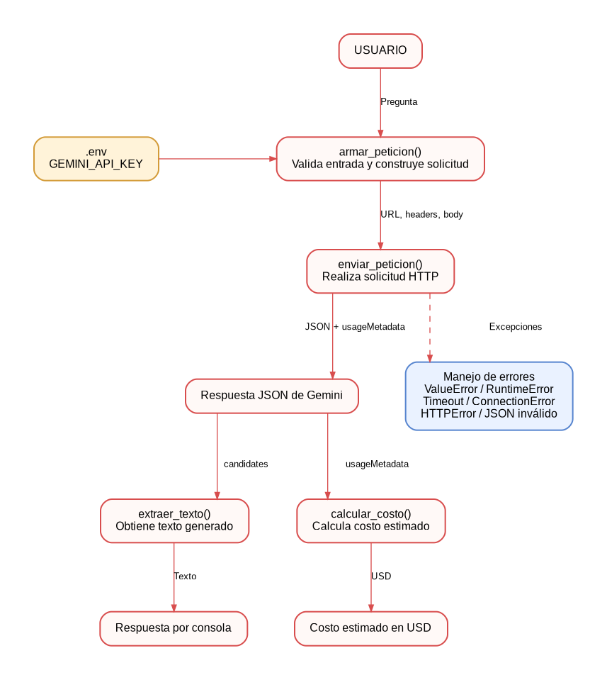

# ADR-001: Selección del modelo de lenguaje

**Proyecto:** ModelLab AI  
**Fecha:** 23-10-2026  
**Estado:** Decisión para prototipo  
**Responsable:** Diego Miranda

## 1. Modelo elegido

Se selecciona `gemini-3.8-flash` como modelo inicial para el desarrollo experimental de ModelLab AI, mediante la API REST de Google Gemini.

ModelLab AI busca facilitar la interpretación de métricas, el diagnóstico de problemas y la explicación de resultados de modelos de Machine Learning.

La selección es provisional: se reevaluara cuando se disponga de pruebas representativas de calidad para estas tareas.

## 2. Diagrama de arquitectura

El sistema separa la construcción de la solicitud, el envío HTTP y el procesamiento de respuestas.

El archivo fuente editable es `arquitectura.dot`. También se dispone de una versión SVG.

La clave `GEMINI_API_KEY` se obtiene desde `.env` utilizando `python-dotenv` y se transmite mediante la cabecera `x-goog-api-key`.

El módulo contiene funciones para extraer texto y calcular costos a partir de `usageMetadata`.

## 3. Comparación de candidatos

Se compararon `gemini-3.8-flash` y `gemini-3.6-flash`, mediante cuatro intentos por modelo con una misma pregunta sobre overfitting.

**Fecha de medición:** 21-10-2026.

| Criterio | Gemini 3.8 Flash | Gemini 3.6 Flash |
|---|---:|---:|
| Precio entrada, USD/1.000 tokens | 0.00075 | 0.00075 |
| Precio salida, USD/1.000 tokens | 0.00375 | 0.00375 |
| Respuestas exitosas | 2/4 | 4/4 |
| Latencia media exitosa | 27.00 s | 7.92 s |
| Tokens de entrada medios | 16 | 16 |
| Tokens de salida facturables medios | 1261 | 1316.8 |
| Costo medio por petición exitosa | USD 0.00474075 | USD 0.00494981 |

Las latencias se promediaron únicamente entre las peticiones exitosas. Gemini 3.8 presentó dos errores por agotamiento del tiempo de espera.

### Evaluación de calidad

Las respuestas registradas explican el concepto de sobreajuste y proponen técnicas de prevención.

No se aplicó una rúbrica cuantitativa de calidad en el benchmark inicial. Sin embargo, gemini-3.8-flash corresponde a una evolución natural de los modelos gemini se la serie 3-flash, por lo que se asume que su desempeño en tareas generales debe ser superior (demostrado por benchmarks oficiales).

### Fuente de evidencia

- [Comparación experimental completa](comparacion_modelos.md)
- [Precios oficiales de Gemini](https://ai.google.dev/gemini-api/docs/pricing)
- [Documentación de modelos](https://ai.google.dev/gemini-api/docs/models)

## 4. Justificación de la elección

Se selecciona provisionalmente Gemini 3.8 Flash porque el proyecto está orientado a interpretar modelos y resolver tareas técnicas de Machine Learning.

Google posiciona este modelo para tareas complejas y flujos relacionados con ingeniería de software.

En el contexto actual, ModelLab AI es un prototipo educativo que prioriza la exploración de capacidades sobre la respuesta inmediata.

Aunque Gemini 3.6 Flash presentó una menor latencia y mayor porcentaje de solicitudes exitosas en las pruebas iniciales, se mantiene la preferencia por Gemini 3.8 Flash para investigar su potencial en tareas de análisis técnico y Machine Learning. Esto debido a que el proveedor señala mediante benchmarks claras mejoras respecto a su predecesor. La selección definitiva dependerá de futuras evaluaciones de calidad, disponibilidad y rendimiento.

## 5. Alternativa descartada

`gemini-3.6-flash` no se selecciona como modelo principal del prototipo.

Sin embargo, sus resultados fueron favorables: respondió los cuatro intentos y presentó una latencia considerablemente menor.

Se conservará como alternativa técnica para tareas simples o situaciones donde la velocidad y la disponibilidad sean prioritarias.

Si Gemini 3.8 mantiene tasas elevadas de timeout o no ofrece ventajas significativas en calidad, se reconsiderará la decisión.

## 6. Riesgos y trabajo futuro

- Repetir pruebas de latencia con más muestras.
- Evaluar calidad mediante una rúbrica común.
- Limitar la longitud de respuestas para controlar costos.
- Implementar reintentos controlados ante errores temporales.
- Evaluar escalabilidad y límites de cuota antes del despliegue.

La arquitectura mantiene el modelo configurable mediante `GEMINI_MODEL`, facilitando comparaciones posteriores.

## 7. Validación posterior y selección operativa del modelo

**Fecha de evaluación:** 23 de octubre de 2026.

Durante la implementación del banco de prompts de la Unidad U1.5 se intentó utilizar inicialmente `gemini-3.8-flash`, de acuerdo con la decisión arquitectónica original. Sin embargo, durante estas pruebas se presentaron reiterados errores HTTP 403 que impidieron continuar con la validación.

Por este motivo, se utilizó `gemini-3.6-flash` como modelo operativo alternativo para completar el experimento, manteniendo los mismos prompts y esquemas de respuesta.

### Resultados experimentales

Se realizaron tres peticiones por cada uno de los tres prompts del banco, para un total de nueve intentos.

| Prompt | Respuestas válidas | Fallos |
|---|---:|---:|
| Diagnosticar sobreajuste | 2/3 | 1 HTTP 503 |
| Recomendar mejoras | 3/3 | 0 |
| Interpretar métricas | 0/3 | 3 HTTP 429 |
| **Total** | **5/9** | **4** |

Todas las respuestas recibidas exitosamente cumplieron la estructura JSON esperada. Los fallos registrados corresponden a errores HTTP del servicio y no a respuestas con formatos inválidos.

En consecuencia, la tasa global de solicitudes exitosas fue del 55,56 %, mientras que la validez estructural de las respuestas efectivamente recibidas fue del 100 % (5/5). Estas métricas evalúan aspectos diferentes y no deben confundirse.

### Revisión de la decisión

Se mantiene `gemini-3.8-flash` como modelo preferido para futuras evaluaciones, debido a las capacidades que el proveedor atribuye a esta generación y a su potencial para tareas técnicas complejas. No obstante, las pruebas iniciales favorecen a Gemini 3.6 en latencia y tasa de solicitudes exitosas.

Por tanto, se adopta la siguiente decisión:

- **Modelo preferido para evaluación futura:** `gemini-3.8-flash`.
- **Modelo utilizado para validar el banco de prompts:** `gemini-3.6-flash`.
- **Criterio de selección:** disponibilidad del servicio, calidad de respuesta, costo y latencia observada.

La decisión original se mantiene como hipótesis técnica sujeta a nuevas mediciones. Se priorizará la disponibilidad y reproducibilidad del sistema durante las evaluaciones académicas.

Los resultados completos se encuentran en [`src/prompts/registro_resultados.json`](../src/prompts/registro_resultados.json).