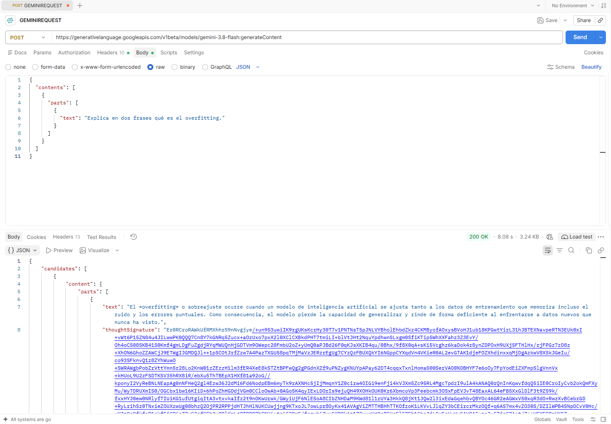

# Evidencia de integración con Gemini

## Objetivo

Demostrar el consumo exitoso de una API generativa externa mediante una petición HTTP POST autenticada.

## Herramientas

- Python 3 y Requests desde WSL2.
- Postman desde Windows.
- Google Gemini API (`gemini-3.8-flash`).

## Endpoint

**Método:** `POST`

**URL:**
`https://generativelanguage.googleapis.com/v1beta/models/gemini-3.8-flash:generateContent`

## Autenticación

Se utiliza el encabezado `x-goog-api-key`, con una clave privada almacenada en el archivo `.env` para el cliente Python.

## Resultado

La solicitud fue ejecutada satisfactoriamente:

- Código HTTP: `200 OK`.
- Respuesta: JSON válido.
- Resultado: explicación educativa sobre el concepto de *overfitting*.

## Evidencia

